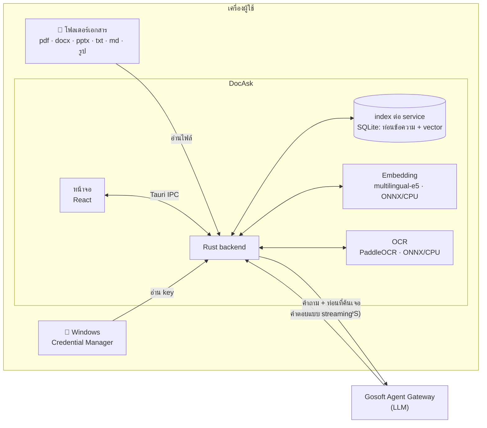
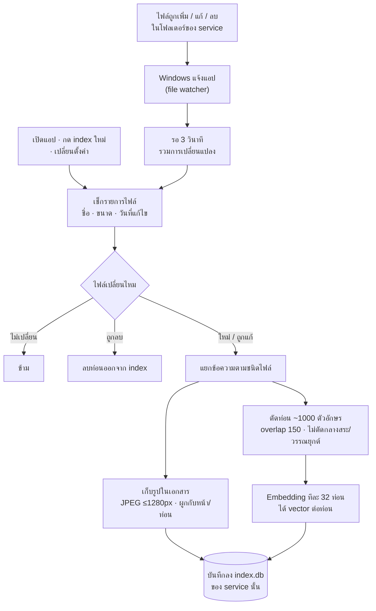
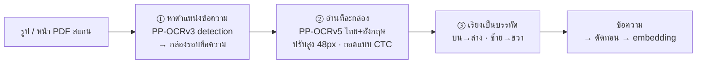
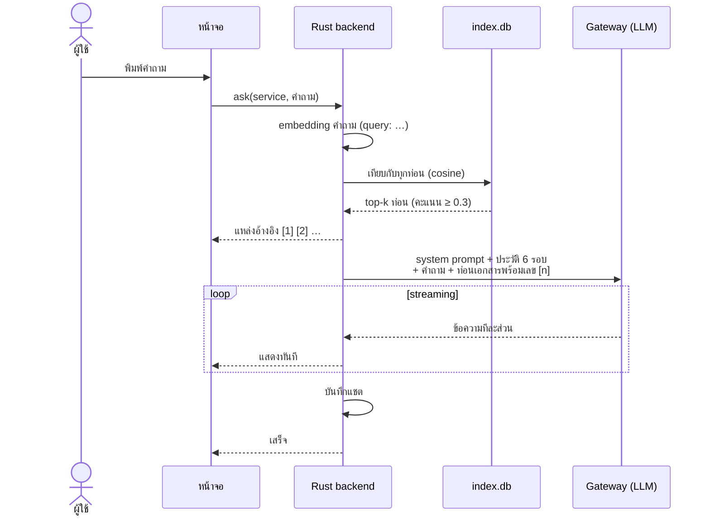
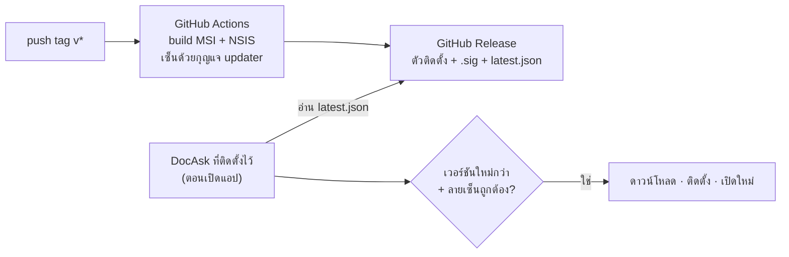

# DocAsk

แอปถามตอบจากเอกสารในเครื่อง (local RAG) สำหรับ Windows ใช้ LLM ผ่าน **Gosoft Agent Gateway**
เอกสารและ index อยู่ในเครื่องทั้งหมด อ่านได้ทั้ง PDF, Word, PowerPoint, ข้อความ และรูปภาพ (มี OCR ภาษาไทยในตัว)

## ⬇️ ดาวน์โหลด

**[ดาวน์โหลดเวอร์ชันล่าสุด](https://github.com/bebarboss/local_notebook/releases/latest)** แล้วเลือกไฟล์ `DocAsk_x.y.z_x64-setup.exe`

| ไฟล์ | ใช้เมื่อ |
|---|---|
| `DocAsk_x.y.z_x64-setup.exe` | **แนะนำ** ติดตั้งให้ผู้ใช้คนเดียว ไม่ต้องใช้สิทธิ์ admin |
| `DocAsk_x.y.z_x64_en-US.msi` | ติดตั้งแบบ silent / ผ่านระบบจัดการเครื่อง (`msiexec /i <ไฟล์>.msi /qn`) |

## 🚀 ติดตั้งและเริ่มใช้งาน

**ต้องมี:** Windows 10/11 64-bit · VPN ของบริษัท (ตอนถามคำถาม) · Virtual Key ของ Gateway (ขึ้นต้น `sk-`)

1. **ติดตั้ง** — ดับเบิลคลิก `DocAsk_x.y.z_x64-setup.exe`
   ถ้า Windows ขึ้น "Windows protected your PC" ให้กด **More info › Run anyway** (ตัวติดตั้งไม่ได้เซ็นด้วยใบรับรอง)
2. **Setup Wizard** (ขึ้นอัตโนมัติเมื่อเปิดครั้งแรก)
   1. Gateway URL — ใช้ค่าเริ่มต้น `https://agent-gateway.gosoft.co.th` ได้เลย
   2. Virtual Key — วาง key แล้วกดบันทึก (เก็บใน Windows Credential Manager)
   3. โมเดล — ใช้ 6 โมเดลตั้งต้น หรือ **นำเข้าจาก VS Code**
   4. ทดสอบ — กดทดสอบ โมเดลที่ผ่านจะพร้อมใช้
3. **โมเดล Embedding** — ตั้งค่า › Embedding และ Index › **ดาวน์โหลด** `multilingual-e5-small` (~120 MB ครั้งเดียว)
4. **สร้าง Service** — เมนูซ้าย › จัดการ › เพิ่ม service › เลือกโฟลเดอร์เอกสาร แล้วรอ index เสร็จ
5. **ถาม** — แชตใหม่ › เลือก service › พิมพ์คำถาม · กด `[1]` `[2]` ในคำตอบเพื่อดูท่อนเอกสารที่อ้างถึง
   ถ้าหน้าที่อ้างถึงมีรูป (screenshot, แผนภาพ, หน้าสแกน) จะแสดงรูปเล็กใต้คำตอบ กดเพื่อดูรูปเต็ม

**เอาเอกสารออกทีละไฟล์:** ปุ่ม **เอกสาร** มุมขวาบนของแชต › ชี้ที่ไฟล์ › ไอคอนถังขยะ
(ไฟล์ต้นฉบับไม่ถูกลบ ถ้าไฟล์อยู่ในโฟลเดอร์ที่ติดตาม จะถูกข้ามจนกว่าจะกด "นำกลับ" ในรายการ "ไฟล์ที่เอาออก")

**อัปเดต:** เมื่อมีเวอร์ชันใหม่ แอปจะขึ้นแถบแจ้งตอนเปิดโปรแกรม กด **อัปเดต** แล้วแอปจะติดตั้งและเปิดใหม่เอง
ข้อมูลเดิม (แชต, index, ตั้งค่า, key) ยังอยู่ครบ

> ⚠️ ใช้ **Virtual Key รายบุคคล** เท่านั้น ห้ามใช้ Master Key และห้ามส่ง screenshot ที่เห็น key

---

## หลักการทำงาน

### ภาพรวม



- **ไม่ส่งออกจากเครื่อง:** ไฟล์เอกสาร, index, vector, รูปที่ทำ OCR
- **ส่งไปที่ Gateway ตอนถามเท่านั้น:** คำถาม, ท่อนเอกสารที่ค้นเจอ (ค่าเริ่มต้น 5 ท่อน) และประวัติแชต 6 รอบล่าสุด
- **Virtual Key** อยู่ใน Credential Manager มีแค่ Rust ที่อ่านได้ หน้าจอเห็นแค่ 4 ตัวท้าย

### 1. การทำ index เอกสาร



ไฟล์ที่ถูก "เอาออก" จากแผงเอกสารจะถูกข้ามในขั้นเช็กรายการไฟล์
แอปไม่ได้สแกนตลอดเวลา จะทำงานเฉพาะตอนที่มีไฟล์เปลี่ยน และทำ embedding เฉพาะไฟล์ใหม่หรือไฟล์ที่ถูกแก้
ถ้าเปลี่ยนโมเดล embedding, ขนาดท่อน หรือเปิด/ปิด OCR แอปจะ index ใหม่ทั้งหมดหนึ่งครั้ง

**การแยกข้อความตามชนิดไฟล์**

| ชนิด | วิธีอ่าน |
|---|---|
| `.pdf` | ข้อความจาก PDFium (เก็บเลขหน้า) · หน้าที่เป็นภาพสแกน → OCR ทั้งหน้า · รูปในหน้า เช่น screenshot → OCR ต่อท้ายหน้านั้น |
| `.docx` | ข้อความในเอกสาร + OCR รูปที่แทรกไว้ |
| `.pptx` | ทีละสไลด์ (เลขสไลด์ = เลขหน้าในการอ้างอิง) + speaker notes + OCR รูปในสไลด์ |
| `.txt` `.md` | ข้อความล้วน (UTF-8 / UTF-16) |
| `.png` `.jpg` `.jpeg` `.bmp` `.webp` `.tif` | OCR ทั้งรูป |

ยังไม่รองรับ: `.doc` / `.ppt` รุ่นเก่า (ให้ Save As เป็น `.docx` / `.pptx`), `.xlsx`, ลายมือ, ข้อความแนวตั้ง

### 2. OCR (อ่านข้อความในรูป)



- โมเดล PaddleOCR (แปลงเป็น ONNX) และ `pdfium.dll` แนบมากับตัวติดตั้งแล้ว รวมประมาณ 17 MB
- รันบน CPU ใช้เวลาประมาณ 0.5–2 วินาทีต่อรูปหรือหน้าสแกน
- กล่องข้อความที่ความมั่นใจต่ำกว่า 0.5 จะถูกตัดทิ้ง รูปเล็กกว่า 120×40 px (เช่นไอคอน) จะไม่ถูกส่งไป OCR และรูปที่ซ้ำกันทุกหน้า เช่นโลโก้ จะ OCR แค่ครั้งเดียว
- เปิด/ปิดได้ที่ ตั้งค่า › Embedding และ Index › OCR ข้อความในรูปภาพ

### 3. การถามตอบ



- **Prompt** สั่งให้ตอบเป็นภาษาเดียวกับคำถาม ใช้เฉพาะข้อมูลจากท่อนเอกสาร (ห้ามใช้ความรู้ภายนอก) และใส่เลข `[n]` อ้างอิง ถ้าในเอกสารไม่มีคำตอบ ต้องบอกว่าไม่พบ
  แต่ละ service เพิ่ม system prompt ของตัวเองได้
- **ถามต่อในแชตเดิม** — ส่งคำถามและคำตอบ 6 รอบล่าสุดไปด้วย แต่ค้นเอกสารใหม่ทุกครั้ง (ไม่ส่งท่อนเอกสารของรอบก่อน)
- **ค้นทุก service** — เปิดได้ที่ช่องพิมพ์ แอปจะค้นทุก index แล้วรวมผลตามคะแนน

### 4. รูปจากเอกสาร

ตอนทำ index แอปเก็บรูปในเอกสารไว้ใน index ด้วย (ย่อเป็น JPEG ด้านยาวไม่เกิน 1280px) แล้วผูกกับตำแหน่งที่รูปอยู่

| ชนิด | รูปที่เก็บ | ผูกกับ |
|---|---|---|
| `.pdf` | รูปในหน้า (≥120×40 px) · หน้าสแกนเก็บภาพทั้งหน้า | หน้า |
| `.pptx` | รูปในสไลด์ | สไลด์ |
| `.docx` | รูปในเนื้อเอกสาร ตามตำแหน่งจริง | ท่อนที่รูปอยู่ |
| รูปภาพ | ตัวไฟล์เอง | ทั้งไฟล์ |

เมื่อคำตอบอ้าง `[n]` แอปจะแสดงรูปจากหน้า/ท่อนนั้นใต้คำตอบ (สูงสุด 8 รูป) และในแผงแหล่งอ้างอิง
รูปที่ซ้ำกันในเอกสาร เช่นโลโก้ เก็บครั้งเดียว · **รูปไม่ถูกส่งไป Gateway** (AI ไม่เห็นรูป เห็นแค่ข้อความที่ OCR อ่านได้)
ปิดได้ที่ ตั้งค่า › Embedding และ Index › แสดงรูปจากเอกสาร

### 5. Service และพื้นที่จัดเก็บ

แต่ละ service คือกลุ่มเอกสารที่มี index แยกกัน (`%APPDATA%\DocAsk\services\<id>\index.db`) และมีโมเดล, reasoning effort, top-k
และ system prompt ของตัวเอง ลบ, ส่งออก หรือ index ใหม่ทีละ service ได้

ไม่จำกัดพื้นที่ต่อ service ไฟล์ต้นฉบับไม่ถูกคัดลอกมาเก็บ index ใช้พื้นที่ประมาณ **10–20 KB ต่อหน้าเอกสาร**
(เอกสาร 1,000 หน้า ≈ 15 MB) บวกรูปที่เก็บไว้ราว 50–150 KB ต่อรูป · ดูขนาด index จริงได้ที่การ์ด service และแผงเอกสาร การค้นหาเทียบทุกท่อนโดยตรง จึงเร็วพอสำหรับเอกสารหลายพันหน้าต่อ service

```
%APPDATA%\DocAsk\
  settings.json            ตั้งค่าแอป (ไม่มี key)
  gateway.json             Gateway URL (ไม่มี key)
  models.json              รายการโมเดล LLM
  services.json            รายการ service
  models\<embedding>\      โมเดล embedding ที่ดาวน์โหลด
  services\<id>\index.db   index ของแต่ละ service
  chats.db                 ประวัติแชต
```

ลบทั้งหมดได้ที่ ตั้งค่า › เกี่ยวกับ › ลบข้อมูลทั้งหมด (การถอนติดตั้งไม่ลบข้อมูลเหล่านี้)

### 6. การอัปเดตโปรแกรม



แอปจะติดตั้งเฉพาะไฟล์ที่เซ็นด้วยกุญแจของโปรเจกต์นี้เท่านั้น เครื่องที่ติดตั้งแบบ NSIS จะอัปเดตด้วย NSIS และเครื่องที่ติดตั้งแบบ MSI จะอัปเดตด้วย MSI

## แก้ปัญหาที่พบบ่อย

| อาการ | ตรวจสอบ |
|---|---|
| ต่อ Gateway ไม่ได้ | ต่อ VPN แล้วลองใหม่ · ตรวจ Gateway URL · แอปใช้ proxy และ certificate ของ Windows อัตโนมัติ |
| 401 | Key หมดอายุ ผิด หรือถูก revoke — ตั้งค่า › Gateway และ Key › Update API Key |
| 403 | ไม่มีสิทธิ์ใช้โมเดลนี้ — ตรวจสิทธิ์กับ Admin |
| 404 | Gateway URL หรือชื่อโมเดลไม่ถูกต้อง |
| 429 | เกินโควตา — รอสักครู่หรือติดต่อ Admin |
| ดาวน์โหลดโมเดล embedding ไม่ได้ | เครือข่ายบล็อก huggingface.co — ดาวน์โหลดจากเครื่องอื่น แล้วใช้ "เลือกโฟลเดอร์" (ดูด้านล่าง) |
| PDF ภาษาไทยอ่านออกมาเพี้ยน | กด `[n]` ดูข้อความที่อ่านได้ · ลองพิมพ์เป็น PDF ใหม่ หรือแปลงเป็นรูปให้ OCR อ่าน |
| PDF สแกน / รูป ถูกข้าม | ตรวจว่าเปิด OCR อยู่ · รูปที่ไม่มีข้อความจะแสดง "ไม่พบข้อความในรูปภาพ" |

<details>
<summary><b>ใช้โมเดล embedding แบบ offline</b></summary>

| โมเดล | ขนาด | หมายเหตุ |
|---|---|---|
| `multilingual-e5-small` (int8) | ~120 MB | ค่าเริ่มต้น เร็ว |
| `multilingual-e5-base` (int8) | ~280 MB | แม่นขึ้น |
| `bge-m3` (int8) | ~570 MB | แม่นที่สุด ใช้ RAM มาก |

ดาวน์โหลดไฟล์จาก `https://huggingface.co/Xenova/<model>` วางเป็นโครงสร้างนี้ แล้วกด "เลือกโฟลเดอร์" ในหน้าตั้งค่า

```
multilingual-e5-small\
  onnx\model_quantized.onnx
  tokenizer.json
  config.json
  special_tokens_map.json
  tokenizer_config.json
```
</details>

---

## สำหรับนักพัฒนา

<details>
<summary><b>Build จาก source</b></summary>

เครื่องมือ: Node.js 20+, Rust stable (MSVC), Visual Studio Build Tools 2022 (workload *Desktop development with C++*)

```powershell
npm install
npm run dev              # หน้าจอในเบราว์เซอร์ http://localhost:5173 (mock mode อัตโนมัติ ไม่ต้องมี Rust)
npm run tauri dev        # แอปจริง + hot reload
npm run tauri build      # ตัวติดตั้ง MSI + NSIS (ต้องมี env TAURI_SIGNING_PRIVATE_KEY)
cd src-tauri; cargo test # unit test ฝั่ง Rust
npm run typecheck
```

- โมเดล OCR และ `pdfium.dll` ไม่อยู่ใน git — `scripts/fetch-ocr.mjs` ดาวน์โหลดเวอร์ชันที่ pin ไว้ให้อัตโนมัติก่อน dev/build
- build โดยไม่เซ็น: `npm run tauri build -- --config '{"bundle":{"createUpdaterArtifacts":false}}'`
- Mock mode: `http://localhost:5173/?setup=done&page=chat` ข้าม wizard · ใน console `docaskMock.vpn(false)` จำลอง VPN หลุด
</details>

<details>
<summary><b>ออกเวอร์ชันใหม่</b></summary>

1. แก้ `"version"` ใน `package.json` และ `src-tauri/Cargo.toml`
2. commit แล้ว push tag ที่ตรงกับเวอร์ชัน
   ```powershell
   git tag v0.3.0; git push origin main v0.3.0
   ```
3. GitHub Actions ([release.yml](.github/workflows/release.yml)) จะ build, เซ็น และสร้าง Release พร้อม `latest.json`

ต้องตั้ง secret `TAURI_SIGNING_PRIVATE_KEY` (เนื้อหาไฟล์ `%USERPROFILE%\.tauri\docask-updater.key`) ไว้ใน repo หนึ่งครั้ง
**ห้าม commit กุญแจลับ** ถ้าทำหาย เครื่องที่ติดตั้งไปแล้วจะรับอัปเดตไม่ได้อีก
</details>

<details>
<summary><b>โครงสร้างโค้ด</b></summary>

```
src-tauri/src/
  lib.rs, commands.rs      จุดเริ่มแอป, Tauri commands, RAG ask + prompt
  config.rs, secrets.rs    settings, models.json, Virtual Key ↔ Credential Manager
  llm.rs, gateway_test.rs  Chat Completions + SSE streaming, ทดสอบโมเดล
  errors.rs, redact.rs     ข้อความ error, ตัด sk-... ออกจากทุกข้อความ
  ingest/                  pdf / docx / pptx / text / image, ocr, chunker ภาษาไทย, watcher, indexer
  embed.rs                 fastembed (ONNX, CPU)
  store.rs, search.rs      SQLite ต่อ service + vector search
  services.rs, chats.rs    service registry, ประวัติแชต
  updater.rs               ตรวจ/ติดตั้งอัปเดต
src/
  pages/      Chat, NewChat, Services, Setup, Settings
  components/ Sidebar, MessageList, Composer, SourcePanel, ServiceEditor, …
  lib/        api.ts (IPC wrapper), mock.ts, types.ts
```
</details>

<details>
<summary><b>ความปลอดภัย</b></summary>

- หน้าจอเรียกได้เฉพาะ Tauri IPC (CSP `connect-src ipc:`) ไม่มี HTTP ออกจากหน้าจอ
- การอ่านไฟล์, เรียก Gateway และจัดการ key อยู่ใน Rust ทั้งหมด หน้าจอรู้แค่ "มี key แล้ว" และ 4 ตัวท้าย
- ทุกข้อความ error ผ่าน `redact()` (ตัด `sk-...`, `Bearer ...`, ฟิลด์ api_key)
- ไม่มี API key ใน repo, test หรือ config

รายละเอียดความต้องการทั้งหมดอยู่ใน [SPEC.md](SPEC.md)
</details>
